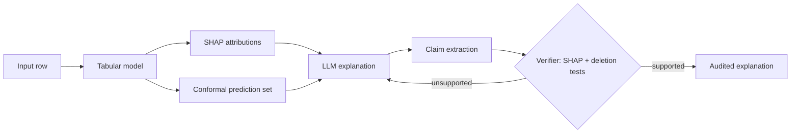

# TrustAudit

**Agentic auditing of tabular ML models: explanations, uncertainty, and verified claims.**

[](https://github.com/avanikumar/TrustAudit/actions/workflows/ci.yml)


> **Status: in development.** The project scaffold is in place and components are being implemented one at a time. See the [roadmap](#roadmap) for what is done and what is planned. Nothing is claimed here that is not tracked in [`docs/PROGRESS.md`](docs/PROGRESS.md).

## Overview

LLMs can write fluent explanations of why a model made a prediction, but fluent does not mean faithful. An explanation may cite a feature that had little influence on the output, or get the direction of an effect wrong.

TrustAudit is an agent that audits tabular ML predictions end to end:

1. Makes a prediction with a trained tabular model.
2. Computes **SHAP** feature attributions for it.
3. Quantifies **uncertainty** with conformal prediction.
4. Has an LLM write a plain-language explanation.
5. **Verifies** each claim in that explanation against the model's actual behaviour (SHAP values and feature-deletion tests), and rejects claims that are not supported.

## How it works



### Components

| Component | Purpose | Module |
|---|---|---|
| Data loading | Train / calibration / test splits | `src/trustaudit/data` |
| Models | LightGBM first; CatBoost and TabPFN planned | `src/trustaudit/models` |
| Explanations | SHAP attributions per prediction | `src/trustaudit/explain` |
| Uncertainty | Split conformal prediction | `src/trustaudit/uncertainty` |
| Verifier | Claim extraction and deletion tests | `src/trustaudit/verifier` |
| Agent | LangGraph loop with reject-and-retry | `src/trustaudit/agent` |
| API | FastAPI service | `src/trustaudit/api` |

## Roadmap

- [x] Project scaffold, CI, test setup
- [ ] Data loader (one dataset)
- [ ] LightGBM baseline
- [ ] SHAP explanations
- [ ] Split conformal prediction
- [ ] Deletion-test verifier
- [ ] LLM narrative and claim extraction
- [ ] LangGraph agent loop
- [ ] FastAPI endpoint
- [ ] Docker
- [ ] Evaluation of explanation faithfulness across datasets (finance, healthcare, churn), with ablations on the verifier and RAG grounding

## Getting started

```bash
git clone https://github.com/avanikumar/TrustAudit.git
cd TrustAudit

python -m venv .venv
source .venv/bin/activate        # Windows: .venv\Scripts\activate

pip install -r requirements.txt
pip install -e .

cp .env.example .env             # add your LLM provider settings
pytest
```

## Project structure

```
TrustAudit/
├── src/trustaudit/
│   ├── data/          # dataset loading and splits
│   ├── models/        # model training
│   ├── explain/       # SHAP
│   ├── uncertainty/   # conformal prediction
│   ├── verifier/      # claim extraction, deletion tests
│   ├── agent/         # LangGraph workflow, LLM wrapper
│   └── api/           # FastAPI app
├── tests/
├── notebooks/
├── docs/              # architecture notes, progress log
└── .github/workflows/ # CI
```

## Design notes

Design decisions and trade-offs are written up in [`docs/ARCHITECTURE.md`](docs/ARCHITECTURE.md).

## License

MIT. See [LICENSE](LICENSE)
