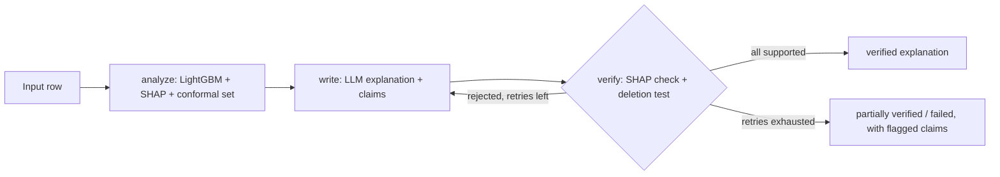

# TrustAudit

**Agentic auditing of tabular ML models: explanations, uncertainty, and verified claims.**

[](https://github.com/avanikumar/TrustAudit/actions/workflows/ci.yml)


LLMs can write fluent explanations of why a model made a prediction, but fluent does not mean faithful. An explanation may cite a feature that barely mattered, or get the direction of an effect backwards.

TrustAudit is an agent that audits a tabular ML prediction end to end. It makes the prediction, measures its uncertainty, has an LLM explain it, and then **checks every claim in that explanation against the model's actual behaviour**. Claims that fail are sent back to the LLM with the reason, and claims that still fail after the retry limit are flagged rather than hidden.

## How it works



The agent is a [LangGraph](https://github.com/langchain-ai/langgraph) state machine (`src/trustaudit/agent.py`):

| Node | What it does | Uses an LLM? |
|---|---|---|
| `analyze` | Predicted probability, SHAP attributions, split-conformal prediction set | No |
| `write` | LLM writes a 2–4 sentence explanation and lists each claim as JSON: `{feature, direction, strength}` | Yes |
| `verify` | Checks each claim (below). Rejection reasons become feedback for the next draft | No |
| `finalize` | `verified`, `partially_verified` or `failed`, plus the full draft history | No |

The LLM only writes. Every fact it may state comes from deterministic tools, and every claim it makes is checked before it is accepted.

### The verifier

A claim such as *"tenure strongly decreases churn risk"* becomes `{"feature": "tenure", "direction": "decreases", "strength": "strong"}`. It is supported only if both checks pass:

1. **SHAP check.** The feature's SHAP value has the claimed sign. A `strong` claim must be about a top-3 feature and a `moderate` one about a top-6 feature. `weak` only needs the right sign, because understating an effect is not a falsehood.
2. **Deletion test.** The feature is replaced with 50 values drawn from the training data, and the prediction is recomputed. The average change in **log-odds** must move in the claimed direction by at least 0.05. Log-odds are used instead of probability because probabilities saturate: for a customer at 2% risk, even an important feature barely moves the probability.

The two checks are independent views of the model. SHAP attributes the prediction to features, while the deletion test actually intervenes on the model.

## Results

All numbers below come from `results/` and can be reproduced with the commands in [Reproduce](#reproduce). Splits are stratified 60/20/20 train/calibration/test, with seed 42.

### Model and uncertainty

| Dataset | Rows | Test AUC | Coverage at 90% target | Coverage at 95% target |
|---|---|---|---|---|
| Telco churn | 7,043 | 0.807 | 88.9% (avg set size 1.25) | 95.1% (avg set size 1.45) |
| Breast cancer | 569 | 0.995 | 93.0% (avg set size 0.94) | 97.4% (avg set size 1.00) |

On the cancer data, an average set size below 1 means some prediction sets are empty: the model is very confident, and a 114-row calibration set makes the threshold coarse.

### Verifier: does it catch wrong claims?

For each test row, three claims with known truth are generated:
- **correct:** a top-3 feature in its true direction, claimed `strong`
- **flipped:** a top-3 feature in the wrong direction
- **exaggerated:** a bottom-half feature claimed `strong`

| Dataset (rows) | Checks | Accepts correct | Rejects flipped | Rejects exaggerated |
|---|---|---|---|---|
| Telco (200) | SHAP only | 100% | 100% | 100% |
| | Deletion only | 97.0% | 97.0% | 52.5% |
| | **Both** | **97.0%** | **100%** | **100%** |
| Cancer (114) | SHAP only | 100% | 100% | 100% |
| | Deletion only | 99.1% | 100% | 70.2% |
| | **Both** | **99.1%** | **100%** | **100%** |

**How to read this.** The ground truth here is defined from SHAP, so "SHAP only" is perfect by construction. That row is a sanity check, not a result. The informative row is **deletion only**: an independent intervention test agrees with SHAP's direction on 97–100% of top features. It does not catch exaggeration by itself (52–70%), because it checks direction and a minimum effect, not rank. That is why both checks are used.

**What the disagreements show.** In about 3% of Telco rows, SHAP and the deletion test disagree on a true top-3 claim. These are mostly correlated features: `TotalCharges` is roughly `tenure × MonthlyCharges`, so removing one of them alone tells a different story than SHAP's attribution. In those cases TrustAudit rejects the claim rather than guessing which view is right. That is conservative, and it is the main source of false rejections.

### Agent loop (simulated writer)

To test the reject-and-retry mechanics without an API key, `NoisyWriter` corrupts each claim with 40% probability (flipped, or replaced with an exaggerated claim), dropping to 20% after feedback. **This is a simulation, not an LLM result.**

| Dataset (rows) | Claims supported, first draft | Claims supported, final | Verified | Partially verified | Failed | Mean attempts |
|---|---|---|---|---|---|---|
| Telco (100) | 59.7% | 88.0% | 76% | 22% | 2% | 2.26 |
| Cancer (100) | 62.7% | 89.3% | 80% | 19% | 1% | 2.18 |

### Agent loop with a real LLM

Not run yet. Run it with your own key (see below) and the results will be written to `results/`.

## Quickstart

```bash
git clone https://github.com/avanikumar/TrustAudit.git
cd TrustAudit
python -m venv .venv
source .venv/bin/activate          # Windows: .venv\Scripts\activate
pip install -e ".[dev]"

pytest                             # 21 tests, no data download or API key needed
```

Telco data: download `WA_Fn-UseC_-Telco-Customer-Churn.csv` from [Kaggle](https://www.kaggle.com/datasets/blastchar/telco-customer-churn) and save it as `data/telco.csv`. The cancer dataset ships with scikit-learn.

### Audit one prediction

```bash
python -m trustaudit.agent telco 0       # dataset, test-row index
```

With no API key set, the offline `TemplateWriter` is used. It only restates SHAP, so it is useful for demos but is not an LLM test. To use a real LLM (any OpenAI-compatible endpoint):

```bash
export GROQ_API_KEY="your-key"           # Windows PowerShell: $env:GROQ_API_KEY="your-key"
# optional: TRUSTAUDIT_MODEL, TRUSTAUDIT_BASE_URL, TRUSTAUDIT_API_KEY_ENV (see .env.example)
python -m trustaudit.agent telco 0
```

### Reproduce

```bash
python -m trustaudit.model telco                  # AUC
python -m trustaudit.conformal telco              # coverage
python -m trustaudit.evaluate verifier --dataset telco  --n 200 --out results/verifier_telco.json
python -m trustaudit.evaluate verifier --dataset cancer --n 200 --out results/verifier_cancer.json
python -m trustaudit.evaluate agent --dataset telco --n 100 --writer noisy --out results/agent_telco_noisy_sim.json
# real LLM (needs GROQ_API_KEY):
python -m trustaudit.evaluate agent --dataset telco --n 50 --out results/agent_telco_llm.json
```

### API

```bash
uvicorn trustaudit.api:app --port 8000   # then open http://localhost:8000/docs
```

- `GET /health` returns the dataset and which writer is active
- `GET /schema` returns the expected columns and an example row
- `POST /audit` with `{"features": {...}}` returns the probability, prediction set, explanation, status and per-claim verdicts

Docker (defaults to the bundled cancer dataset; pass `-e TRUSTAUDIT_DATASET=telco` with `data/telco.csv` present):

```bash
docker build -t trustaudit .
docker run -p 8000:8000 -e GROQ_API_KEY trustaudit
```

## Project structure

```
src/trustaudit/
├── data.py        # Telco + breast cancer loaders, stratified 60/20/20 split
├── model.py       # LightGBM baseline
├── explain.py     # SHAP attributions with rank and share
├── conformal.py   # split conformal prediction sets
├── verifier.py    # claim checks: SHAP sign/rank + log-odds deletion test
├── llm.py         # prompt, JSON parsing, OpenAI-compatible + offline writers
├── agent.py       # LangGraph reject-and-retry loop (Auditor)
├── evaluate.py    # verifier ablation + agent evaluation
└── api.py         # FastAPI service
tests/             # 21 tests; fake LLM writers, no network
docs/              # design notes and progress log
results/           # evaluation outputs (JSON)
```

## Limitations

- **The verifier's ground truth is SHAP-derived.** The deletion test is an independent check, but there is no human-labelled set of faithful vs. unfaithful explanations yet.
- **Correlated features cause conservative rejections.** About 3% of true top-feature claims on Telco are rejected because SHAP and the deletion test disagree.
- **Claims are coarse.** Direction and a three-level strength cover only a subset of what an explanation can say. Comparative claims ("X matters more than Y") and value-specific claims ("because tenure is under 6 months") are not checked yet.
- **The LLM lists its own claims.** If the prose mentions an effect the claims list leaves out, that effect is not verified. A separate extraction step would close this gap.
- **No real-LLM results yet.** The agent numbers above come from a simulated writer.
- **Two datasets and one model family** (LightGBM), with a single seed.
- **The Docker image hasn't been tested.** The Dockerfile hasn't been built and run yet.

## Roadmap

- [x] Data loading, LightGBM baseline, SHAP, split conformal prediction
- [x] Deletion-test verifier with SHAP checks and ablation
- [x] LLM explanation with structured claims (OpenAI-compatible + offline)
- [x] LangGraph agent with reject-and-retry
- [x] FastAPI endpoint, Dockerfile, CI, tests
- [x] Second dataset (breast cancer)
- [ ] Real-LLM evaluation (Groq) across both datasets
- [ ] Separate claim-extraction step, checked against the prose
- [ ] Small hand-labelled set of explanations to measure the verifier against people
- [ ] More seeds and confidence intervals; CatBoost / TabPFN models

Design decisions are written up in [`docs/ARCHITECTURE.md`](docs/ARCHITECTURE.md), and progress is tracked in [`docs/PROGRESS.md`](docs/PROGRESS.md).

## License

MIT. See [LICENSE](LICENSE).
